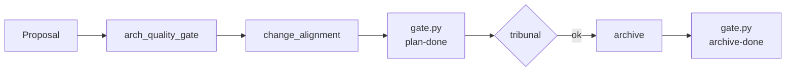

# Gates and Quality

Four quality mechanisms, each with a different scope and severity model.

| Mechanism | Scope | Severity | Where |
|-----------|-------|----------|-------|
| `gate.py` | Single phase transition | error / warning | `_lib/gate.py` |
| `tribunal.py` | Cross-agent validation of a single artefact | error / warning | `_lib/loop/tribunal.py` (imported as `skills._lib.loop.tribunal`) |
| `arch_quality_gate.py` | Architecture proposals (ADRs, gap analyses) | warning only | `_lib/arch_quality_gate.py` |
| `change_alignment.py` | A change vs the architecture | warning only | `_lib/change_alignment.py` |

## Core Invariant

**Warning = soft prompt.** The user sees the warning and chooses to proceed.
**Error = hard block.** The operation cannot continue without resolving.

No quality mechanism silently swallows issues. If a check cannot run (e.g. file missing, schema invalid), it fails as an error — never as a silent pass.

## `gate.py` (ADR-0007)

The general-purpose phase-transition gate. Plugins register checks; each check returns `(level, message)`. Aggregation produces an error/warning report.

Use cases:
- plan-done gate: are all spec deltas + tasks.md + deps-analysis in place?
- archive-done gate: did worktree have commits? are tasks.md checkboxes all done?
- ship-lightweight-mode gate: are there any commits to merge? (blocks archive if 0 commits)

Plugin extension: drop a Python module under `_lib/plugins/` that calls `register_gate_check()` (see `_lib/plugins/README.md` for the contract). Plugins are loaded by explicitly importing them before constructing the `GateMechanism`.

### The archive has TWO gates — do not confuse them

| Gate | What it decides | Where |
|------|-----------------|-------|
| **Trunk gate** (`archive_premerge_check`) | is the implementation branch **already merged into the default branch**? | `_lib/archive.sh` (the `openspec_tracked=false` branch, **before** `openspec archive`) |
| **AC archive gate** (`archive_gate_check`) | is the verdict cache fresh and complete? | `_lib/archive.sh` (the AC-verification block) |

**The archive never merges for you.** `git.openspec_tracked=false` skips `git merge` (per the
`complete-project-yaml-config-gaps` spec's `archive-openspec-tracked-skip-git` requirement) — but an
unmerged implementation is **refused**, with a copy-pasteable command, instead of being archived and then
silently left on a branch that is about to be deleted.

Judgment order (ADR-0061): branch ref missing → refuse; worktree dirty → refuse; already merged → allow;
content-equivalent (patch-id via `git cherry`) → allow with a warning; **not merged → refuse**; cannot
decide → allow with a warning. The three return states are consumed separately by the caller — state `2`
(“cannot decide”) must **not** be folded into a refusal.

Explicit opt-in: `ARCHIVE_ALLOW_UNMERGED=yes` + `RDDF_ARCHIVE_UNMERGED_REASON` (audited; it must not be
combined with `FORCE_BRANCH_DELETE=yes` — that combination deletes the code).

Bypass paths that this gate does **not** cover: `phase0_approval.sh`'s rdd-quick direct-archive path,
and a manual `openspec archive`. The lightweight inline path (`phase3_archive.sh`) is no longer a
bypass: it carries its **own** commit-ownership check (`lightweight_commit_ownership_check`) plus the
same `archive_premerge_check` — called with an empty `wt_path`, because there is no worktree and
main-repo dirt may belong to another change. Its full sequence is enumerated in
`docs/architecture/workflow-phases.md` (Hard gates).

## ADR-0035 双轨边界与 ADR-0060 形态门（增量模式）

**ADR-0035 —— verifier 与 archive-gate 的双轨边界**：验收与归档是两道**不同**的门，各读各的工件：

| 轨 | 判据 | 工件 | 真源 |
|---|---|---|---|
| verifier | AC 是否逐条满足 | `.rddf/state/verifier/.ac-verdict-<change>.json`（判决缓存） | `_lib/verifier/` |
| archive gate | 判决缓存是否**新鲜且完整** | 同一份缓存 | `_lib/archive.sh::archive_gate_check` |

边界（写清楚就不容易互相顶替）：

- verifier 判「实现对不对」；archive gate **不重判 AC**，只判缓存可用（缺失 / 过期 / 不完整 ⇒ 拒绝归档）。
- 缓存的**唯一写入口**是 verifier；archive gate 只读。
- 缓存锚点是**实现分支 tip**，不是 `HEAD` —— 在 `openspec_tracked=false` 的仓里 HEAD 已被切回默认分支，
  用 HEAD 当锚点会把一份好缓存误判成过期。

**ADR-0060 —— ADR 形态门（增量模式）**：形态门判 ADR 是否越出「决策文档」边界（行数预算、必备章节、
Verification 章、备选方案表、过程日志、Status 行长度）。它原本是「永远 opt-in」的警告：本仓 163 项存量形态债里
有 56 项是事后补不了的 `missing_verification`（ADR-0060 的「不追溯」），所以清存量这条路走不通。

现在它是**增量门**（`fix-adr-shape-debt-convergence`）：

| 概念 | 落点 |
|---|---|
| 冻结账本（per-file × per-signal） | `docs/adr/.adr-shape-baseline.json`（163 项存量） |
| 增量判定 | `adr_shape_check.sh --all --diff-baseline` —— 只报基线外的新增 |
| ratchet | 基线**只降不升**：新增债务先修 ADR，不能记进账本 |
| CI | `.github/workflows/test.yml` 的「ADR shape gate」step（无 `if:`，实际执行） |
| 本地门 | `./test.sh --gates` 跑同一条命令（镜像门 `test_ci_local_mirror.py` 守住） |

判据本身**一条没放宽**（信号集 / 250 行预算 / 200 字符 Status 预算都不动）—— 增量的是**账本**，不是判据。

## `tribunal.py` (ADR-0008)

Multi-agent cross-validation. Given an artefact (proposal, design.md, etc.), it runs N reviewer agents and aggregates weighted scores. Sensitive content (paths, env vars, secrets) is sanitised via `_lib/loop/sanitizer.py` (imported as `skills._lib.loop.sanitizer`) before review.

Use cases:
- Verifying an improvement proposal's quality before it enters `improvement-approved.md`.
- Cross-checking a generated implementation plan against its source design.md.

Tribunal scores are advisory unless explicitly wired into a hard gate.

## `arch_quality_gate.py` (ADR-0018)

Four warning-level checks run on architecture artefacts (ADRs, gap analyses):

1. **alignment** — does the proposal reference existing ADRs (when relevant)?
2. **debt** — does it acknowledge trade-offs or technical debt?
3. **clarity** — is the rationale unambiguous?
4. **actionable** — does it produce a concrete next step?

Default: warnings are soft prompts. Set `STRICT_ARCH_GATE=yes` in env to upgrade warnings to errors (CI mode).

## `change_alignment.py` (ADR-0019)

Three warning-level checks run on a change proposal against the current architecture:

1. **refs_valid** — every ADR reference in `proposal.md` actually exists in `docs/adr/`.
2. **no_contradiction** — the change does not contradict an active ADR.
3. **task_traceability** — every `- [ ]` in `tasks.md` traces back to a `##` section in `proposal.md`.

Default: warnings. Set `STRICT_CHANGE_GATE=yes` for CI.

## How the Four Mechanisms Compose

Each phase transition may invoke multiple gates. The phase only advances if all **error-level** checks pass.

## Adding a New Gate

1. Decide scope: phase-transition (`gate.py`), artefact validation (`tribunal.py`), or domain-specific (`*_quality_gate.py`).
2. Implement check as a function returning `(level, message)`.
3. Register in the corresponding registry (`_lib/gate.py::_PLUGIN_REGISTRY` via `register_gate_check()`, or a plugin file under `_lib/plugins/`).
4. Add a test in `tests/unit/` (TDD — write the test first).
5. Document the check name in this file (so future readers know what `STRICT_*_GATE=yes` actually enables).

See [extension-points.md](extension-points.md) for the full pattern.

## Cross-references

- State model: [state-and-events.md](state-and-events.md)
- ADR index: `../adr/README.md`
