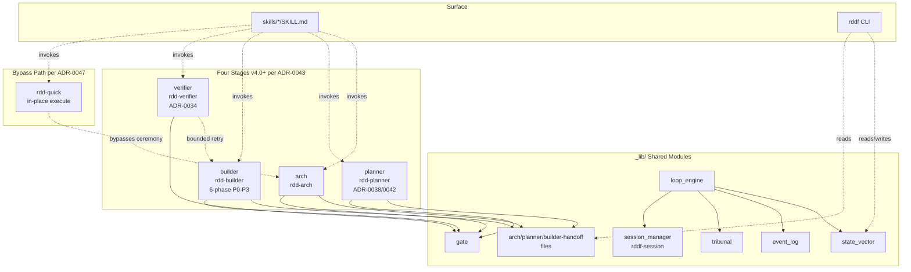

# Overview

## What rdd-workflow Is

rdd-workflow is an **OpenSpec-compatible AI development workflow package**. It manages changes via the OpenSpec change lifecycle (`propose → plan → execute → status → archive` — these are OpenSpec CLI verbs, *not* rdd-workflow stages), wrapped in a **four-stage v4 architecture** (`rdd-arch → rdd-planner → rdd-builder → rdd-verifier`, per ADR-0043), with a `rdd-quick` small-change bypass path (per ADR-0047). It runs on any OpenSpec-aware AI coding assistant (opencode, Claude Code, Cursor, Aider, etc.) via the Skill discovery mechanism, with no runtime dependency on a specific vendor.

The package ships:
- **26 skills** in `skills/` — 5 stage skills (`rdd-arch`, `rdd-planner`, `rdd-builder`, `rdd-verifier` + the `rdd-quick` bypass, v4.0+ per ADR-0043) and 21 sub-skills, each a `SKILL.md` with structured frontmatter.
- A **shared `_lib/`** of 60+ Python modules and bash helpers implementing state, gate, tribunal, session, loop engine, etc.
- A **`rddf` CLI** (`rddf status`, `rddf session ...`, `rddf discover-ship-changes`, etc.) for scripting and dashboards.

## Top-Level Architecture

## Module Map

### Stage skills (skills/)

| Skill | Stage | One-liner |
|-------|-------|-----------|
| `rdd-arch` | Stage 1 — arch | Define architecture: ADR creation + theme doc composition (per ADR-0057). **Does not own roadmap** (per ADR-0048 — detached from roadmap). |
| `rdd-planner` | Stage 2 — planner | Roadmap + proposal authoring orchestrator (per ADR-0038/0042); v3.0 design+plan merged; sole owner of roadmap + `.rddf/improvements/`. |
| `rdd-builder` | Stage 3 — builder | Approval + plan + execute + archive; 6-phase internal state machine (per ADR-0043): P0 → P1 → P1.5 → P2 → P2.5 → P3. |
| `rdd-verifier` | Stage 4 — verifier | Batch AC verification before archive; routes failures back to builder (per ADR-0034); v2.0 self-contained LLM verification (per ADR-0045). |
| `rdd-quick` | Bypass (ADR-0047, AMENDED per ADR-0048) | Small-change in-place execute; skips openspec change + worktree ceremony. Reached as **rdd-builder P0 option 5** (dispatch), not by user request alone. |

### Sub-skills (called by other skills)

> "Called by" is derived from live orchestration references in `skills/*/SKILL.md` — three mechanisms: `skill_use("…")` calls, prose load directives (`加载 <skill> 技能`), and sourced hooks (`source ../<skill>/scripts/*.sh`).
> The recommender entry point is the **`rddf guide` CLI** (ADR-0062 收敛为单一 Python 实现；`skills/guide/` 于 ADR-0063 归档) — it is no longer a skill.

| Skill | One-liner | Called by |
|-------|-----------|-----------|
| `add-improve` | Create an improvement proposal via brainstorming. | rdd-planner |
| `propose` | Legacy proposal skeleton creator for `openspec/changes/<name>/`. | (none) |
| `deps` | Compute change dependency graph + execution order. | (none) |
| `feature` | View/manage feature fragments (summary, graph, status, order). | (none) |
| `rdd-workflow-writing-plans` | Generate TDD 5-step plan for a change. | (none — plan file is produced by rdd-builder P1) |
| `roadmap` | Init / edit / validate / advance the project roadmap. | rdd-planner |
| `rddf-session` | User-perspective workflow session mgmt. | rdd-arch, rdd-builder, rdd-planner, rdd-quick, rdd-verifier (sourced hooks) |
| `rdd-env-check` | Health snapshot of openspec CLI, git, branch (phase-internal script). | (phase-internal) |
| `rdd-workflow-brainstorm` | Structured brainstorm for improvements. | add-improve |
| `openspec-gate` | Pre-commit gate: warn if staged files aren't linked to a change. | (standalone) |
| `contract-check` | Hub OpenAPI contract vs local implementation validator. | (standalone) |
| `cross-repo-protocol` | Hub-Spoke federation MCP client (REST fallback). | (standalone) |
| `report-issue` | Hub-Spoke RFC issue creator (phase-exit hook). | (standalone) |
| `rdd-doctor` | Read-only diagnostic over workflow state files. | (none — invoked as a CLI diagnostic) |
| `rdd-env-bootstrap` | Environment bootstrap orchestrator for rdd-workflow projects. | (none) |
| `rdd-hub-bootstrap` | Hub repo bootstrap (dirs + Projects V2 board + CI templates). | (standalone) |
| `rdd-session-bootstrap` | Cross-session continuity snapshot / paste-ready prompt builder. | (standalone) |
| `session-lesson-mining` | Mine real session history for lessons → mechanical e2e criteria. | (standalone) |
| `spoke-system-prompt-injection` | Federation protocol injector for AI assistant configs. | (standalone) |
| `sync-hub` | Pull Hub contract into `openspec/specs/<name>/spec.md`. | (none) |
| `watch-hub` | One-shot Hub issue status poll (cron / CI). | (standalone) |

### Core _lib/ modules

| Module | One-liner |
|--------|-----------|
| `_lib/core/state_vector.py` | Atomic JSON state, schema-versioned, <10ms read/write. |
| `_lib/core/event_log.py` | Append-only event log; <100ms replay over 10k events. |
| `_lib/gate.py` | Plugin-style quality gate; error/warning levels. |
| `_lib/loop/tribunal.py` | Multi-agent cross-validation; weighted scoring + sanitization. |
| `_lib/loop_engine.py` | Goal → Plan → Execute → Verify → Adapt orchestrator. |
| `_lib/session.py` / `session_manager.py` | rddf-session lifecycle (ADR-0017). |
| `_lib/arch_quality_gate.py` | 4 warning checks on architecture artefacts + opt-in ADR shape budget (`ARCH_SHAPE_CHECK=yes`, per ADR-0060). |
| `_lib/change_alignment.py` | 3 warning checks on change-vs-architecture alignment. |
| `_lib/validate_delta_targets.py` | Validates spec delta `## ADDED/MODIFIED/REMOVED` paths. |
| `_lib/discover-arch-artifacts.sh` | ADR/roadmap/architecture dir discovery (ADR-0016). |

### rddf CLI subcommands

| Subcommand | One-liner |
|------------|-----------|
| `rddf status` | 改进提案状态 + active change 概览（磁盘推导；不读 iteration.json）。 |
| `rddf sessions show/current/gc` | Session lifecycle (CLI side). The user-facing session skill is `rddf-session`; the CLI subcommand is `sessions` (plural). |
| `rddf discover-ship-changes` | List committed changes ready to ship. |
| `rddf layout --json` | Machine-readable `.rddf/` layout manifest (single source of truth: `_lib/core/rddf_layout.py`). |
| `rddf doctor --category <cat>` | Read-only diagnostics over workflow state files. |
| `rddf feedback add` | Single-writer feedback channel for `.rddf/improvements/*.md` (per ADR-0037). |
| `rddf rdd-verify` | Run the AC verification protocol (per ADR-0034/0045). |
| `rddf env-bootstrap` | Environment bootstrap / remediation for rdd-workflow projects. |

> Full list: `rddf --help` (37 subcommands). The table above is a curated subset, not the authoritative index.

## Why Four Stages, Not Three or Five

v1.x used a single `guide.md` with 10 phases (ADR-0001 refactored this into two phases: spec/ship). v2.0 (ADR-0003) refactored again into **three** phases (arch / plan / ship) — splitting at the natural break between "what we want to build" (plan) and "how we build it" (ship).

In practice, **arch** accumulated two distinct responsibilities: defining the **architecture itself** (ADRs, roadmap) and **managing improvement proposals** against that architecture. By v2.0.6 the proposal-review load was heavy enough that a second gate, a content review pass, and a defer mechanism all crowded into arch's Phase 5.5. **ADR-0025** split those responsibilities: `rdd-arch` keeps architecture definition; `rdd-planner` (formerly `guide-design`) owns proposal lifecycle (create → review → approve/reject/defer → two-tier content review). In v4.0 this became a full second stage (per ADR-0038/0042/0043).

In v3.0, AC verification was extracted from the inline `archive_gate_check` (which embedded `ac-verifier`) into a separate fifth phase. **ADR-0034** elevates `rdd-verifier` to its own phase (`discover → batch-verify → classify → route`), giving bounded retry (max 3) and heuristic failure classification (implementation_gap vs proposal_drift) before archive. v2.0 further inlined the LLM verification protocol into the agent itself (per ADR-0045), removing the external `ac-verifier` subprocess.

In v4.0, the design + plan + ship stages were merged into a single `rdd-builder` 6-phase internal state machine (per **ADR-0043** §3.4): approval → plan → deps → execute → review → archive. This collapsed the 5-stage pipeline to 4 stages and added `rdd-quick` as a parallel bypass path (per **ADR-0047**).

This is why the current architecture is **four stages** (`rdd-arch → rdd-planner → rdd-builder → rdd-verifier`, v4.0+ per ADR-0043) plus a `rdd-quick` bypass path. Any doc that still says "three stages" (the v2.0 model) or "five stages" (the v3.0 model) is stale; v4 is four-stage per ADR-0043.

## Why a Loop Engine

In v1.x, the user picked from a fixed menu at each step. This worked for small changes but forced the human to make every routing decision. v2.0 introduced a **Loop engine** (ADR-0004) that runs the cycle Goal → Plan → Execute → Verify → Adapt autonomously when a goal is set, and falls back to a menu when the goal is ambiguous.

ADR-0002 then added **three interaction modes**: `loop` (autonomous until goal met), `menu` (v1-style), `hybrid` (loop tries first, falls back to menu at configurable checkpoints). The mode is per-session; the default is `hybrid`.

See [loop-engine.md](loop-engine.md) for the building-block breakdown.

## Key Design Principles

These are the rules the project holds itself to. When a change seems to violate one, the burden is on the change author to justify it.

1. **Self-contained.** A single skill (with its `scripts/` dir and `_lib/` deps) is enough to do its job. No implicit cross-vendor dependencies (no `~/.claude/...` paths, no hard reliance on a specific AI vendor).
2. **Explicit contract.** Cross-skill data flows through versioned handoff files (`.rddf/state/.arch-handoff.json`, `.rddf/state/.planner-handoff.json`, `.rddf/state/.planner-feedback.json`) with declared schemas. No hidden state-passing via globals.
3. **Idempotent.** Re-running a phase is safe: state-vector writes are atomic, gates re-evaluate, plans re-generate deterministically from inputs.
4. **Single source of truth.** Each fact lives in exactly one place: skill metadata is in `SKILL.md` frontmatter only; state is in `state_vector.py` only; handoffs are in their JSON files only.
5. **No silent failure.** Every error path either surfaces a stderr message + non-zero exit code, or — for recoverable cases — emits a warning gate. Never swallow.
6. **TDD discipline.** Public helpers in `_lib/` are written test-first; the test suite (`./test.sh --full`) gates merges via the regression script.
7. **Skill frontmatter immutability.** The YAML frontmatter of a `SKILL.md` (name, version, evolved-from, user-invocable, etc.) is read-only at runtime. Skill authors do not edit frontmatter to "rebrand"; instead they bump `version` semver.
