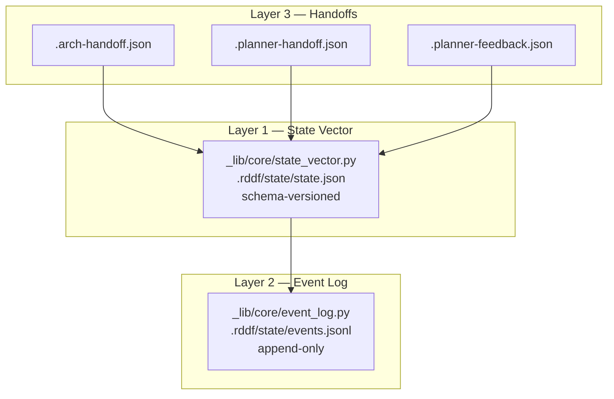

# State and Events

rdd-workflow runs without a database. Instead, state lives in **three distinct layers**, each with a different read/write pattern and lifetime.

## Layer 1 — State Vector (`_lib/core/state_vector.py`, imported as `skills._lib.core.state_vector`)

The **current snapshot** of project state. Schema-versioned JSON; writes are atomic (temp-file + rename). Read/write < 10 ms.

What it holds:
- `goal`, `interaction_mode`, `current_phase`, `current_step`
- Active worktree path + branch
- rddf-session id + last heartbeat
- counters (iterations, retries, gate failures)

When to use: any code path that needs to **query** current state fast. The Loop engine reads from here on every step.

## Layer 2 — Event Log (`_lib/core/event_log.py`, imported as `skills._lib.core.event_log`)

The **history**. Append-only newline-delimited JSON. Each line is an event (`step_started`, `gate_failed`, `human_approved`, `archive_completed`, etc.) with a timestamp + payload.

What it gives you:
- **Replay**: reconstruct state-vector from events up to time T.
- **Audit**: every gate + every human approval is on disk.
- **Debugging**: when a change misbehaves, the log shows what happened step-by-step.

Querying 10k events is < 100 ms (linear scan over small payloads).

## Layer 3 — Handoff Files

**Cross-skill contracts** written to `.rddf/state/`. Each phase writes one handoff on completion; the next phase reads it on entry.

| File | Written by | Read by | Schema version |
|------|-----------|---------|----------------|
| `.arch-handoff.json` | `rdd-arch` (arch-done) | `rdd-planner`, `rdd-builder` | v3（schema `enum: [1,2,3]`，ADR-0016 + ADR-0042） |
| `.planner-handoff.json` | `rdd-planner` (plan-done) | `rdd-builder` | `planner-handoff-v1` + `recommended_route` (ADR-0048) |
| `.planner-feedback.json` | `rdd-builder` (feedback) | `rdd-planner`, `rdd-arch` | `planner-feedback-v1` (ADR-0042) |

Each handoff file is JSON with a `version` field at the top. **Consumers reject version=0 payloads** (forces explicit schema migration).

> **v4 命名说明**：v1~v3 的 `.design-handoff.json` / `.plan-handoff.json` 已废弃 —— v4 合并 design 与 plan 阶段后，handoff 改为 `.planner-handoff.json`（写方 `_lib/planner_handoff.py:77`，读方 `_lib/builder_deps.py:223,234`）。旧文件名仅作 legacy 探测用途保留（`_lib/cli/guide_cmd.py:68-73`；`_lib/recommender.py:133-162` 回退时打「legacy v3 handoff detected」）。

`.rddf/` 的**布局**（有哪些条目、谁读谁写、是否入库）见 [rddf-layout.md](rddf-layout.md) —— 真源是 `_lib/core/rddf_layout.py`。

ADR-0016 also standardised the fields inside `.arch-handoff.json`: `adr_dir`, `roadmap_path`, `architecture_dir`, `adr_pattern`, `discovered`, `version`. These let downstream phases find ADR / roadmap / architecture directories without hardcoded paths.

## Why Three Layers

Each layer answers a different question:

| Question | Answer lives in |
|----------|-----------------|
| "What is the current state?" | State vector |
| "How did we get here?" | Event log |
| "What did the previous phase promise me?" | Handoff files |

If you collapse them, you lose either speed (vector = query speed), history (log = audit), or contract clarity (handoff = cross-phase promise).

## Reading vs Writing

- **Read-heavy**: state vector (queried every step).
- **Write-heavy**: event log (one event per action, but never rewritten).
- **Write-once-then-read-once**: handoff files (phase transition).

Handoff files are the only layer that **must** be read by a different phase than the one that wrote it — they exist to break the implicit coupling of "phase N needs to know what phase N-1 decided".

## 治理状态层（opencode 角色层）—— 不属于本文档的三层

上面三层是 **rdd-workflow 自己的**运行时状态。还有一层**不属于它**：opencode 侧的治理状态，写在同一个
`.rddf/state/` 目录下，但**由 opencode 的角色层读写，rdd-workflow 不读不写**：

| 文件 | 是什么 | 谁写 |
|---|---|---|
| `.rddf/state/role.json` | 治理身份（schema `role-v2`，含 `sessions` 分区） | opencode 角色层 |
| `.rddf/state/pair.json` | 派发登记（pair-v2，`required_when=never`） | opencode 角色层 |
| `.rddf/reviews/*.md` | 验收报告（verifier 角色）/ 审稿报告（architect 角色） | opencode 角色层 |

**字段级清单不在这里**（避免再造一份会过期的副本）—— 文件级布局见
[`rddf-layout.md`](rddf-layout.md) 的「文件级」节；角色层分工见
[`agent-role-alignment.md`](agent-role-alignment.md)。

混放的风险不是「谁覆盖谁」，而是**读错**：把 `role.json` 当成 rdd 的工件去写，会破坏 opencode 的身份链与租约。

## Failure Modes

| Failure | Recovery |
|---------|----------|
| State vector write fails (disk full) | Atomic temp-file + rename prevents partial writes; on rename failure, state stays at last-good value. |
| Event log corruption (truncated) | Detect on read (line parse error), reset to last good offset, log warning. |
| Handoff file missing on phase entry | Treat as phase-not-yet-completed; fall through to entry phase (e.g. `rdd-planner` → `rdd-arch`). |
| Handoff file version mismatch | Consumer rejects; user must re-run prior phase (or run `--force` to override — explicitly opt-in). |

## Cross-references

- Handoff schema: [skills-and-handoff.md](skills-and-handoff.md)
- Loop engine reads state: [loop-engine.md](loop-engine.md)
